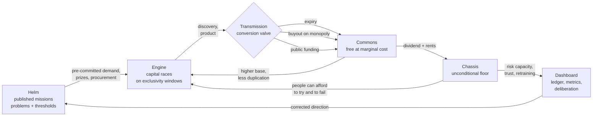

# The Open Nation Framework

**Macro steering + capital engine + social floor — a three-pillar model for a faster-learning society**

> Version 0.2.0 · 2026-10-10 · Status: **draft blueprint**
> 中文版: [FRAMEWORK.zh-CN.md](./FRAMEWORK.zh-CN.md) · Constitutional basis: [Constitution.md](./Constitution.md) · Rule-making: [GOVERNANCE.md](./GOVERNANCE.md)

---

## 0. One paragraph

A society learns faster when three things are true at once. **Someone sets a direction** that no single buyer would pay for — long-horizon, public-good problems — because uncoordinated markets under-invest in those. **Profit-seeking capital races along that direction**, because exclusivity, prizes and pre-committed demand make the race worth running. **The results are converted into common capability on a published schedule**, so the next round of work starts from a higher base instead of repeating the last one. And **nobody who races can fall below a dignified floor**, so people can take risks, retrain, and tell the truth about failure. Direction without an engine is a plan that nobody executes; an engine without a floor is a race that most people refuse to enter; results without conversion are progress that keeps restarting from zero. The three pillars are one machine.

This document specifies the machine, its parameters, its failure modes, and how it would be falsified.

---

## 1. The vehicle: five layers

The design is easier to hold in mind as a vehicle. Each layer is a *power* with a *limit* — the limit is what keeps the layer from eating the others.

| Layer | 中文 | Powers | Limits |
| --- | --- | --- | --- |
| **Helm** — steering | 宏观引导 | Publish long-horizon missions; fund upstream research; buy, prize, standardise | May not command research agendas, conscript labour, or name the winning technology (C10, C12) |
| **Engine** — capital | 资本动力 | Property, contract, profit, exclusive windows, free entry/exit | Exclusivity is time-limited and priced, never perpetual (C16); monopoly triggers buyout (C18) |
| **Transmission** — commons | 全民共享 | Convert private results into public capability; open data; open standards; national dividend | Must carry a maintainer and an endowment (C25); can never be re-monopolised (C19) |
| **Chassis** — floor | 社会兜底 | Unconditional basics, indexed, with a right to useful work | Caps nothing above it (C28); funded from rents, not from the innovation it is trying to accelerate (C30) |
| **Dashboard** — feedback | 集体意识 / 反馈 | The open ledger, the metric suite, sortition deliberation, insulated statistics | Publishes what it cannot verify as `pending:`; unverifiable claims may not be ratified (C3) |

The five layers form a loop, not a hierarchy. That loop is the whole idea:



ASCII version, for terminals and printers:

```
        (5) corrected direction
   ┌──────────────────────────────────────────┐
   │                                          │
   ▼                                          │
 [HELM] ──missions/prizes/procurement──► [ENGINE] ──discovery──► {CONVERSION}
   ▲                                          │                      │
   │                                          │            expiry / buyout /
   │                                          │            public funding
   │                                          ▼                      ▼
 [DASHBOARD] ◄──trust, participation── [CHASSIS] ◄──dividend, rents── [COMMONS]
   ▲                                          │                      │
   └────────── risk capacity, retraining ─────┘        higher base ───┘
                                                        (back to ENGINE)
```

**Read the loop as one sentence:** the state names the problem, capital races for a bounded prize, the result becomes everyone's capability on a published schedule, the floor makes people willing to run the race, and the ledger tells the state whether the direction was right.

---

## 2. The core bargain

Everything else is detail. The central mechanism is a *deal* that both capital and the public accept, written down in advance:

> **Capital gets a short, protected, high-margin head start and a fair buyout. The public gets the capability at marginal cost once the head start ends, plus the tax base and the floor that make the market worth operating in.**

The bargain has four clauses.

### 2.1 Clause one — a bounded head start

Each domain has a published exclusivity window `W_d` (years). Inside the window the inventor may charge what the market bears. Outside it, the capability is free at marginal cost and may not be re-monopolised (including via interface, format, or licence control).

Draft tiers — **parameters, not truths**; each is a `pending:` item until the pilot measures diffusion half-life and private investment per domain:

| Domain | Draft window | Reasoning to be tested |
| --- | --- | --- |
| Software, protocols, tooling | 3 years | Fast iteration, low capital intensity, high interoperability value |
| Data products, models, datasets | 2 years | Value decays fast; commons accelerates the next generation |
| Machinery, materials, manufacturing process | 5 years | Medium capital intensity, medium imitation lag |
| Pharmaceuticals, biologics, medical devices | 7 years (+2 with a genuine new-mechanism finding) | Long trials, high failure cost, safety requires data disclosure |
| Cultural works | 10 years, non-renewable, with a statutory library exception | Long tail matters, but the tail must start |
| Publicly funded research | 0 years | Already paid for once (C22) |

### 2.2 Clause two — the conversion valve

A capability moves into the commons by exactly one of four routes, all published:

1. **Expiry** — automatic, on the date, no application needed.
2. **Buyout on monopoly** — the state pays fair value and releases it (C18).
3. **Public funding** — if the public paid for it, it is public on day one (C22).
4. **Prize and procurement** — the state buys the outcome, not the exclusivity, and publishes the result.

Buyout price, published formula:

```
P = C_realized + α · V_expected
```

- `C_realized` — independently audited cost to date, including failed programmes.
- `V_expected` — modelled social value of release over the assessment horizon.
- `α` — statutory share of that value paid to holders, **draft range 0.10 – 0.30**, capped in absolute terms, with an independent valuation panel and a published appeal route.

Creator share after release, paid over `T` years from the commons fund or the buyout:

```
Share_i = β · V_realized · w_i ,  Σ w_i = 1 ,  β ≤ 0.10
```

where `w_i` is the recorded contribution weight of each creator, and `β` is capped so that release cannot be quietly converted into a perpetual levy. **The purpose of `α` and `β` is not generosity. It is to make invention at least as profitable as rent-seeking**, so that the next cohort chooses to invent.

### 2.3 Clause three — pre-commitment instead of subsidy

The state's main tool for acceleration is *certainty*, not money:

- **Advance purchase commitments** — "we will buy 200 million doses at price X if you deliver by date Y."
- **Prizes** — paid on verified outcome, not on effort.
- **Guaranteed procurement volumes** — a floor under demand for early, expensive output.
- **Milestone payments** — de-risk the middle of a decade-long programme.

This is what lets ordinary capital participate in ten-year problems without needing a ten-year monopoly. It is also the cheapest form of steering: if the state is wrong about the problem, it loses the commitment, not the whole economy.

### 2.4 Clause four — the floor is what makes the race rational

Risk-taking requires a floor. A person with no health care, no housing security, and no retraining path cannot rationally join a race whose median outcome is failure. So the floor is not a cost of the system; it is **input to the engine**:

```
effective risk capacity ≈ f(floor security, expected upside, trust in the rules)
```

Corollary: cutting the floor to "improve incentives" reduces the number of attempts, and with a skewed distribution of research outcomes, the number of attempts is most of the result. This is a testable claim (see §7, F3).

---

## 3. Six conversions that produce the "collective consciousness"

The phrase *more efficient collective consciousness* is used here as a measurable claim about coordination cost, not as mysticism. A society behaves more like one mind when six conversions are cheap:

| # | Conversion | Coordination-cost metric | Mechanism |
| --- | --- | --- | --- |
| 1 | Problem → funded attempt | **coordination latency** (days from mission publication to first funding) | Published mission ledger + pre-committed demand |
| 2 | Attempt → attempt (no repetition) | **duplicate-research ratio** (share of mission spend re-doing known work) | Open commons + mandatory prior-art search + negative-result publication |
| 3 | Discovery → practice | **diffusion half-life** (years to 10% of adoptable population) | Marginal-cost release, open standards, localization duty (C26) |
| 4 | Discovery → next discovery | **citation and reuse breadth** (how many fields build on it within 5 years) | Open data, open code, maintainer endowment (C25) |
| 5 | Citizen → decision | **participation and contestability rate** | Sortition assemblies, referendum, open ledger (C33, C34) |
| 6 | Failure → correction | **time from anomaly to rule change** (amendment latency vs. diffusion half-life) | Five Lines evidence rule, sunsets, retrospective review (C3, C4) |

Each of the six has a number attached. That is the point: "collective consciousness" is only interesting if it is cheaper coordination, and cheaper coordination is measurable. `tools/simulate.mjs` is a first, deliberately crude model of conversions 1–4 (see [docs/SIMULATION.md](./docs/SIMULATION.md)).

---

## 4. Where this differs from existing models

| Model | Direction (helm) | Engine | Diffusion | Floor | Failure it is known for |
| --- | --- | --- | --- | --- | --- |
| Laissez-faire | none | strong | priced, slow for public goods | weak/charity | under-produced public goods, monopoly drift |
| 20th-century command socialism | strong | **absent** | fast on paper | strong | no local knowledge, no initiative, stagnation |
| Social democracy | mild | strong | mixed, priced | strong | direction still set by whoever lobbies best; diffusion still slow |
| State capitalism | strong | strong but politically selected | mixed | weak–mixed | cronyism, capital allocation by connection, monopoly protected as national champion |
| **This framework** | strong, published, capped in number, with kill criteria | strong, with *bounded* exclusivity and pre-committed demand | **by design**: a scheduled conversion valve | strong, unconditional, rent-funded, indexed | untested at scale; vulnerable to valuation capture, mission inflation, and fiscal over-commitment (see §6) |

The differentiator is not "have markets and welfare". It is the **conversion valve**: a published schedule and formula by which private, profitable, exclusive results become public capability — plus an evidence rule that stops the schedule from being rewritten by whoever is winning.

---

## 5. Design tensions, and the rule that resolves each

A framework is defined by how it handles its own contradictions. Five are explicit here.

| Tension | Naive resolution (bad) | Rule used here |
| --- | --- | --- |
| **Incentive vs. diffusion** | lengthen exclusivity (slows diffusion) or abolish it (kills the engine) | Bounded, measured windows per domain + buyout + creator share (C16, C18, C20) |
| **Direction vs. discovery** | pick a technology and bet the nation | Missions state problems and thresholds; many small bets; no direction bans research (C10, C12) |
| **Floor vs. fiscal room** | means-test and humiliate, or promise without funding | Rent-based funding, published indexation formula, sovereign fund rules (C29, C30, C32) |
| **Speed vs. safety** | emergency powers that never end, or paralysis | Time-boxed emergency powers; trial-by-default laws with sunsets; fast-track + retrospective review (C4, C41, C43) |
| **Openness vs. privacy/security** | publish everything, or classify everything | Open by default for state data, closed for persons; `pending:` for unverifiable claims; defence exceptions with audit (C7, C3) |

---

## 6. Failure modes and countermeasures

This blueprint is only as good as its list of ways to fail. Every row is something a critic would say, and the countermeasure that must exist *inside the design*, not in the goodwill of the people running it.

| # | Failure mode | Early symptom | Countermeasure in this framework |
| --- | --- | --- | --- |
| F1 | **Mission inflation** — every interest gets a mission | mission count grows faster than mission completions | Cap on concurrent missions; kill criteria; closures published; sunset of the mission programme itself (C11) |
| F2 | **Capture of direction** — the ledger follows the lobbyists | authorship correlates with asset returns | Anti-capture: disclosure, divestment, cooling-off, sortition authorship (C5) |
| F3 | **Valuation capture** — buyouts become a subsidy channel | `α` creeps up, valuations driven by incumbents | Formula in law, independent panel, published appeal, absolute cap, retrospective audit (C18, C20) |
| F4 | **Capital flight after nationalization** | net outflows exceed value of released commons | Fair value, non-retroactive rules, free exit, competitive talent and market offer (C21) |
| F5 | **Commons rot** — open-sourced and abandoned | unnamed maintainers, security debt | Maintenance endowment and named maintainer mandatory before release (C25) |
| F6 | **Floor fiscal blowout** | floor growth > productivity growth for a decade | Rent base, indexation band, sovereign fund drawdown rules, published stress test (C29, C30) |
| F7 | **Participation drop** — floor becomes a substitute for work | hours and training enrolment fall | Floor stays unconditional; job/training guarantee offered at or above floor wage; measure, then resize (C31, C27) |
| F8 | **Foreign free-riding** — others sell into the market without contributing | commons used commercially with zero return | Reciprocity clause: market access conditioned on reciprocal commons contribution, in law, applied symmetrically (Commons Law) |
| F9 | **Measurement gaming** | metrics improve while lived experience does not | Insulated statistics office, independent audit, replication requirement, capability index instead of GDP-only (C35, C36) |
| F10 | **Ledger theatre** | the ledger is complete but unused | Publish only what changes decisions; measure use in deliberations and markets; shrink what is unused (C33) |
| F11 | **Amendment lag** — technology moves faster than law | amendment latency > diffusion half-life | Fast-track path with mandatory retrospective review; sunsets on every non-rights rule (C41, C4) |
| F12 | **Founder capture / blueprint cult** | "the framework says so" replaces argument | Everything carries a falsifier; parameter values are `pending:` until measured; forks encouraged (C48, §8) |

---

## 7. What would refute this framework

Honest design means writing the refutation before someone else does. The framework fails if any of these is observed:

- **F1⁺** Mission setting does not beat untargeted funding: published missions show no better cost-per-discovery than the same money spent as open research grants (C9).
- **F2⁺** Bounded exclusivity kills the engine: in every domain tested, shortening windows reduces private investment more than it accelerates diffusion, so total welfare falls (C16).
- **F3⁺** The floor reduces attempts: unconditional security measurably reduces the rate of new ventures, retraining and research entry, beyond any health or participation gain (C27).
- **F4⁺** Conversion is not worth its cost: buyouts plus maintenance cost more than the deadweight loss they remove, across domains (C18, C25).
- **F5⁺** Collective-intelligence metrics do not predict: coordination latency, duplicate ratio and diffusion half-life have no predictive power over later capability growth compared with R&D spend alone (C37).

Any one of these does not automatically kill the framework — it kills *a parameter or a layer*, which is why they are written as article-level falsifiers. But if F1⁺ and F2⁺ both hold, the steering and engine layers must be rebuilt, and the blueprint should say so plainly.

**The illustrative model already argues with this framework.** [docs/SIMULATION.md](./docs/SIMULATION.md) — an uncalibrated mechanism model with invented parameters — was deliberately not tuned to flatter these pages, and it does not: with its assumptions, the parameter sweep prefers 20-year windows over the tiers in §2.1, the command scenario beats the framework on the output measure and on floor adequacy in every year, and the framework's capability-index margin over command flips sign under three single-parameter changes. That is the correct behaviour of evidence in this project: the model is a sparring partner, not a testimonial. What it supports is that the loop *can* work as described and which parameters decide the answer; what it cannot do is choose the parameters. Only a pilot can.

---

## 8. Roadmap

| Stage | Scale | What is being tested | Exit criterion |
| --- | --- | --- | --- |
| **0 — Blueprint** (now) | repository | whether the rules can be made explicit, sourced and falsifiable at all | external forks, external critique, at least one independent evidence pack |
| **1 — Pilot** | 10k – 1M people, under a host state's law or a chartered zone | the floor's affordability, the conversion valve's parameters (`W_d`, `α`, `β`), participation, capital attraction | pre-registered hypotheses resolved, results published including failures, residents stay and new ones arrive |
| **2 — Region** | a region of an existing state | scaling of governance, ledger and statistics; capital mobility; reciprocity rules at a real border | audited results survive 10× scale |
| **3 — Nation** | a state, by referendum on audited results | whether the loop compounds | metric suite improves faster than comparable jurisdictions |

Deliberately missing from the roadmap: a founding date, a leader, a flag, a territory claim. The project is a blueprint and a pilot design. Anyone may fork it and start stage 1 in their own jurisdiction; the framework takes no position on where.

---

## 9. Objection register

**"This is just state capitalism with welfare."**
State capitalism selects firms by political connection and protects national champions. This framework publishes the selection rule as a problem statement, caps missions, requires kill criteria, and *forces divestment of monopoly* rather than protecting it. The conversion valve is the part state capitalism never has.

**"Capital will never accept a 3-year window."**
It already does in software, fashion, and much of consumer hardware, where imitation lag is short and speed wins. It does not in pharmaceuticals, which is why that tier is 7 years plus trials. The windows are parameters to be measured, not an ideology — and the pre-commitment clause (§2.3) is what makes a short window bankable.

**"A floor makes people lazy."**
Testable, and tested repeatedly in cash-transfer literature: unconditional transfers do not generally reduce labour supply, and they improve health and schooling. The framework makes this a falsifier rather than an assumption (F3⁺), and pairs the floor with a work/training guarantee so the offer of useful activity is never absent.

**"Open-sourcing results means nobody invests in research."**
Only if the window is zero everywhere. The framework makes the *default end state* open, not the default *start*. Publicly funded research is the exception, and it is open because it was already paid for.

**"Who decides the direction? That is where tyranny enters."**
Direction-setting is the highest-stakes power in the model, which is why it is the most constrained: missions state problems, not technologies; the number is capped; kill criteria are pre-registered; authorship is sortition-based with disclosure; and the ledger is public. The claim is not that this cannot be captured — it is that capture is *detectable in the published data*, which is a lower bar and a more honest one.

**"This is utopian; it will never be adopted."**
Adoption is not the current claim. The current claim is narrower: these rules are explicit, their parameters are measurable, and a pilot of 10,000 people could test the load-bearing parts. A blueprint that can be refuted by a pilot is not utopian; it is a hypothesis.

---

## 10. Files in this framework

| File | Role |
| --- | --- |
| [Constitution.md](./Constitution.md) | Root law: principles, rights, powers, amendment, transition |
| [FRAMEWORK.md](./FRAMEWORK.md) | This document: the architecture, the bargain, the failure modes |
| [FRAMEWORK.zh-CN.md](./FRAMEWORK.zh-CN.md) | 中文版框架 |
| [GOVERNANCE.md](./GOVERNANCE.md) | How a rule becomes law: proposal → evidence → review → vote → sunset → audit |
| [CONTRIBUTING.md](./CONTRIBUTING.md) | How to contribute, and what counts as a contribution |
| laws/ | Operational law, one file per domain, each with machine-readable metadata |
| schema/law-meta.schema.json | Schema for the metadata block in every law |
| tools/nation.mjs | Validator and index generator (`validate`, `index`, `graph`) |
| tools/simulate.mjs | Illustrative stock-flow model of the loop |
| docs/SIMULATION.md | Simulation output and interpretation |
| LAW_INDEX.md | Generated index of all laws and their evidence status |

---

## 11. The one-line version

**Set the direction publicly, let capital race for a bounded prize, convert the result into everyone's capability on a published schedule, and guarantee that no one who races falls through the floor — then measure whether the society is actually learning faster, and publish the answer even when it is no.**
