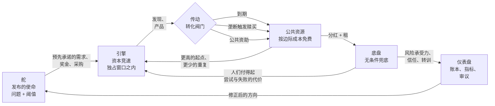

# 开放国家框架

**宏观引导 + 资本动力 + 社会兜底 —— 一个让社会更快学习的三支柱模型**

> Version 0.2.0 · 2026-10-10 · Status: **draft blueprint（草案蓝图）**
> 本文为 [FRAMEWORK.md](./FRAMEWORK.md) 的**翻译快照**（对应英文版 0.2.0，2026-10-10）；英文版更新后本文即过期，以英文版为准——校验器不跟踪翻译漂移，这一行是唯一的契约。
> 宪法基础：[Constitution.md](./Constitution.md) · 立法与修法流程：[GOVERNANCE.md](./GOVERNANCE.md)

---

## 0. 一段话

一个社会若想学得更快，需要三件事同时成立。**有人为无人付费的长周期公共品设定方向** —— 不协调的市场对这类问题总是投入不足。**逐利的资本沿这个方向竞速** —— 因为独占期、奖金与预先承诺的需求让这场竞赛值得参加。**成果按公布的时刻表转化为公共能力** —— 于是下一轮工作从更高的起点开始，而不是重复上一轮。而**参赛者不会跌穿一条有尊严的底线** —— 于是人们敢于冒险、敢于转训、敢于如实报告失败。没有引擎的方向是无人执行的规划；没有底线的引擎是多数人拒绝进入的竞赛；没有转化的成果是不断从零重启的进步。三根支柱是一台机器。

本文规定这台机器、它的参数、它的失败模式，以及如何证伪它。

---

## 1. 载体：五个层次

把这组设计想象成一辆车更好把握。每一层都是一种**权力**，配一条**限制** —— 限制的作用是防止任何一层吞掉其他层。

| 层次 | 中文 | 权力 | 限制 |
| --- | --- | --- | --- |
| **舵（helm）** —— 宏观引导 | 宏观引导 | 发布长周期使命；资助上游研究；购买、设奖、立标准 | 不得命令研究议程、征调劳动、或指定获胜技术（C10、C12） |
| **引擎（engine）** —— 资本动力 | 资本动力 | 财产、契约、利润、独占窗口、自由进出 | 独占有期限、有对价，绝不永续（C16）；垄断触发赎买（C18） |
| **传动（transmission）** —— 全民共享 | 全民共享 | 把私人成果转化为公共能力；开放数据；开放标准；国家分红 | 必须配备维护者与维护基金（C25）；永远不得被再垄断（C19） |
| **底盘（chassis）** —— 社会兜底 | 社会兜底 | 无条件的基本保障、按公式指数化、有用工作权 | 不封顶其上的任何东西（C28）；以租而非以它想加速的创新为财源（C30） |
| **仪表盘（dashboard）** —— 反馈 | 集体意识 / 反馈 | 开放账本、指标体系、抽签审议、独立统计 | 无法核验的只标 `pending:`；不可核验的主张不得通过为法律（C3） |

五个层次构成一个回路，而不是一个层级。这个回路就是全部思想：



终端/打印用的 ASCII 版本：

```
                (5) 修正后的方向
        ┌─────────────────────────────────────────────┐
        │                                             │
        ▼                                             │
   [舵] ──使命/奖金/采购──► [引擎] ──发现──► {转化阀门}
        ▲                    │                        │
        │                    │              到期 / 赎买 /
        │                    │              公共资助
        │                    ▼                        ▼
 [仪表盘] ◄──信任、参与──── [底盘] ◄──分红、租──── [公共资源]
        ▲                    │                        │
        └──── 风险承受力、转训 ────┘      更高起点 ──────┘
                                          （回到引擎）
```

**把回路读成一句话：** 国家公布问题，资本为一段有界的奖金竞速，成果按公布的时刻表成为所有人的能力，兜底让人们愿意参赛，账本告诉国家方向是否定对了。

---

## 2. 核心交易

其余都是细节。核心机制是一份资本与公众**双方都接受、且事先写明**的交易：

> **资本获得一段短期、受保护、高利润的先发优势与一次公平赎买。公众在先发优势结束后以边际成本获得该能力，并获得让这个市场值得运转的税基与底盘。**

这份交易有四个条款。

### 2.1 条款一 —— 有界的先发优势

每个领域有一个公布的独占期 `W_d`（年）。窗口之内，发明人可按市场能承受的价格收费。窗口之外，该能力以边际成本免费，且不得以任何方式被再垄断（包括通过接口、格式、许可或标准控制）。

草案的分层 —— 是**参数，不是真理**；在试点测得各领域的扩散半衰期与私人投资之前，每一项都是 `pending:`：

| 领域 | 草案窗口 | 待检验的理由 |
| --- | --- | --- |
| 软件、协议、工具 | 3 年 | 迭代快、资本强度低、互操作价值高 |
| 数据产品、模型、数据集 | 2 年 | 价值衰减快；公共化加速下一代 |
| 机械、材料、制造工艺 | 5 年 | 中等资本强度、中等模仿时滞 |
| 药品、生物制品、医疗器械 | 7 年（真正的全新机制可 +2） | 试验周期长、失败成本高、安全要求数据披露 |
| 文化作品 | 10 年，不可续期，法定图书馆例外 | 长尾重要，但长尾必须开始 |
| 公共资助的研究 | 0 年 | 已经付过一次钱（C22） |

### 2.2 条款二 —— 转化阀门

一项能力通过且仅通过以下四条公布的路径之一进入公共资源：

1. **到期** —— 到日自动，无需申请。
2. **垄断赎买** —— 国家按公允价值买断并释放（C18）。
3. **公共资助** —— 公众付过钱的，第一天就是公共的（C22）。
4. **奖金与采购** —— 国家买的是结果而不是独占权，并公布结果。

赎买价格，公布公式：

```
P = C_realized + α · V_expected
```

- `C_realized` —— 经独立审计的实际成本，含失败的研发项目。
- `V_expected` —— 在评估期内释放的社会价值模型值。
- `α` —— 支付给权利人的法定份额，**草案区间 0.10 – 0.30**，有绝对上限，由独立估值小组评定，并公布申诉渠道。

释放后的创造者份额，从公共资源基金或赎买款中分 `T` 年支付：

```
Share_i = β · V_realized · w_i ,  Σ w_i = 1 ,  β ≤ 0.10
```

其中 `w_i` 是记录在案的贡献权重，`β` 设上限以使释放不会被悄悄变成一项永续征税。**`α` 与 `β` 的目的不是慷慨，而是让发明的回报至少不低于寻租** —— 于是下一批人选择发明。

### 2.3 条款三 —— 预先承诺而不是补贴

国家加速资本的主要工具是**确定性**，不是钱：

- **预先采购承诺** —— “若你在 Y 日前交付，我们以价格 X 采购 2 亿剂。”
- **奖金** —— 按验证过的结果支付，不为努力支付。
- **保证采购量** —— 为早期昂贵产出托底。
- **里程碑付款** —— 为十年期项目的中段去风险。

这正是让普通资本能参与十年期难题的原因，而不需要一份十年的垄断。它也是最便宜的引导：如果国家看错了问题，损失的只是这份承诺，而不是整个经济。

### 2.4 条款四 —— 兜底让竞赛变得理性

承担风险需要底线。一个没有医保、住房没有保障、没有转训路径的人，无法理性地加入一场中位数结局是失败的竞赛。所以兜底不是系统的成本，而是**引擎的输入**：

```
有效风险承受力 ≈ f(兜底安全度, 预期上行空间, 对规则的信任)
```

推论：为“改善激励”而削减兜底，会减少尝试的次数；而在研究产出高度偏态的分布下，尝试次数几乎就是结果本身。这是一个可检验的命题（见 §7 之 F3⁺）。

---

## 3. 六个转化，产出“集体意识”

*更有效率的集体意识*在这里是一个关于协同成本的**可测量**主张，不是神秘主义。当以下六个转化变得便宜时，一个社会才更像一个心智：

| # | 转化 | 协同成本指标 | 机制 |
| --- | --- | --- | --- |
| 1 | 问题 → 获资助的尝试 | **协同时延**（使命发布到第一笔资助的天数） | 公布的使命账本 + 预先承诺的需求 |
| 2 | 尝试 → 尝试（不重复） | **重复研究率**（使命经费中重复已知工作的比例） | 开放公共资源 + 强制现有技术检索 + 阴性结果发表 |
| 3 | 发现 → 应用 | **扩散半衰期**（达到可采纳人口 10% 的年数） | 边际成本释放、开放标准、本地化义务（C26） |
| 4 | 发现 → 下一个发现 | **引用与复用广度**（5 年内有多少领域在其上构建） | 开放数据、开放代码、维护基金（C25） |
| 5 | 公民 → 决策 | **参与与可争议率** | 抽签议会、公投、开放账本（C33、C34） |
| 6 | 失败 → 纠正 | **从异常到规则改变的时间**（修法时滞 vs 扩散半衰期） | 五要素证据规则、日落条款、事后审查（C3、C4） |

六项各有编号。这正是要点：**“集体意识”只有在它是更便宜的协同时才有意义，而更便宜的协同是可以测量的。** `tools/simulate.mjs` 是对转化 1–4 的第一个、刻意粗糙的模型（见 [docs/SIMULATION.md](./docs/SIMULATION.md)）。

---

## 4. 与现有模式的差别

| 模式 | 方向（舵） | 引擎 | 扩散 | 兜底 | 已知的失败 |
| --- | --- | --- | --- | --- | --- |
| 自由放任 | 无 | 强 | 有价，公共品慢 | 弱/慈善 | 公共品供给不足、垄断漂移 |
| 二十世纪计划社会主义 | 强 | **缺席** | 纸面快 | 强 | 无局部知识、无主动性、停滞 |
| 社会民主 | 弱 | 强 | 混合、有价 | 强 | 方向仍由游说能力决定；扩散仍慢 |
| 国家资本主义 | 强 | 强但由政治挑选 | 混合 | 弱—混合 | 任人唯亲、按关系配置资本、垄断被当作国家冠军保护 |
| **本框架** | 强、公布、数量有上限、有终止条件 | 强、独占**有界**、有预先承诺需求 | **按设计**：有时刻表的转化阀门 | 强、无条件、以租为源、指数化 | 未在大规模验证；易受估值俘获、使命膨胀与财政超支（见 §6） |

差异化之处不是“既有市场又有福利”，而是**转化阀门**：一份公布的时刻表与公式，规定私人、营利、独占的成果如何变成公共能力 —— 加上一条防止时刻表被暂时的赢家改写的证据规则。

---

## 5. 设计张力，及消解每条张力的规则

一个框架由它如何处理自身的矛盾来定义。这里明示五条。

| 张力 | 天真的解法（坏） | 本文采用的规则 |
| --- | --- | --- |
| **激励 vs 扩散** | 延长独占（拖慢扩散）或废除独占（杀死引擎） | 按领域设界、可测量的窗口 + 赎买 + 创造者份额（C16、C18、C20） |
| **方向 vs 发现** | 选定一门技术押上全国 | 使命只陈述问题与阈值；多笔小额下注；不禁止任何研究方向（C10、C12） |
| **兜底 vs 财政空间** | 家计调查加羞辱，或者无资金承诺 | 以租为源、公布指数化公式、主权基金规则（C29、C30、C32） |
| **速度 vs 安全** | 永不结束的紧急权力，或者瘫痪 | 有时限的紧急权力；默认试行的日落条款；快速通道 + 事后审查（C4、C41、C43） |
| **开放 vs 隐私/安全** | 全部公开或全部保密 | 国家数据默认开放、个人默认保密；不可核验的主张标 `pending:`；国防例外须受审计（C7、C3） |

---

## 6. 失败模式与对策

这份蓝图的可信度等于它列出的失败清单。每一行都是批评者会说的话，而对策必须存在于**设计内部**，而不是寄托在运行者的善意上。

| # | 失败模式 | 早期症状 | 本框架内的对策 |
| --- | --- | --- | --- |
| F1 | **使命膨胀** —— 每个利益集团都有使命 | 使命数量的增长快于使命的完成 | 并发使命上限；终止条件；关闭须公布；使命计划本身日落（C11） |
| F2 | **方向被俘获** —— 账本跟着游说走 | 规则作者身份与资产回报相关 | 反俘获：披露、剥离、冷却期、抽签起草（C5） |
| F3 | **估值俘获** —— 赎买变成补贴渠道 | `α` 向上爬，估值由在位者主导 | 公式入法、独立小组、公布申诉、绝对上限、事后审计（C18、C20） |
| F4 | **国有化后的资本外流** | 净流出超过释放的公共资源价值 | 公允价值、不溯及既往、自由退出、有竞争力的人才与市场（C21） |
| F5 | **公共资源腐烂** —— 开源之后被遗弃 | 无维护者、安全债务 | 释放前强制维护基金与指名维护者（C25） |
| F6 | **兜底财政崩坏** | 兜底增长十年超过生产率增长 | 租基、指数化区间、主权基金提取规则、公布的压力测试（C29、C30） |
| F7 | **参与下降** —— 兜底变成工作的替代 | 工时与培训入学下降 | 兜底保持无条件；提供不低于兜底工资的工作/培训；测量后再调整规模（C31、C27） |
| F8 | **外国搭便车** —— 他人向本市场销售却不贡献 | 公共资源被商业使用而零回报 | 互惠条款：市场准入以对等贡献为条件，写入法律、对称适用（Commons Law） |
| F9 | **指标博弈** | 指标改善而生活体验未改善 | 独立统计、独立审计、复现要求、能力指数而非仅 GDP（C35、C36） |
| F10 | **账本表演** | 账本完整但无人使用 | 只发布能改变决策的数据；测量审议与市场中的实际使用；删减无人使用者（C33） |
| F11 | **修法滞后** —— 技术快于法律 | 修法时滞 > 扩散半衰期 | 带强制事后审查的快速通道；非权利规则一律日落（C41、C4） |
| F12 | **起草者俘获 / 蓝图崇拜** | “框架是这么说的”取代了论证 | 每条带证伪条件；参数值在测得前一律 `pending:`；鼓励分叉（C48、§8） |

---

## 7. 什么会推翻这个框架

诚实的设计意味着先于别人写下推翻自己的条件。若观察到以下任何一项，框架即失败：

- **F1⁺** 使命设定不优于无定向资助：公布的使命在单位成本的发现数上不优于把同样的钱作为开放研究资助发放（C9）。
- **F2⁺** 有界独占杀死引擎：在所有测过的领域，缩短窗口对私人投资的抑制都超过对扩散的加速，总福利下降（C16）。
- **F3⁺** 兜底减少了尝试：无条件的保障在健康与参与收益之外，可测量地降低了新事业、转训与研究进入的速率（C27）。
- **F4⁺** 转化不抵成本：赎买加维护的成本超过其消除的无谓损失，跨领域成立（C18、C25）。
- **F5⁺** 集体智慧指标无预测力：协同时延、重复率与扩散半衰期对后来的能力增长的预测力不如单纯的研发支出（C37）。

其中任何一项并不自动杀死整个框架 —— 它杀死的是**某个参数或某一层**，这正是它们被写成条款级证伪条件的原因。但如果 F1⁺ 与 F2⁺ 同时成立，引导层与引擎层必须重建，而蓝图应当坦然这么说。

**示意模型已经在与本框架争吵。** [docs/SIMULATION.md](./docs/SIMULATION.md) —— 一个未经校准、参数纯属发明的机制模型 —— 刻意没有被调成讨好这几页纸的样子，它也确实没有：在其假设下，参数扫描更偏爱 20 年窗口而非 §2.1 的分层；指令式情景在产出指标与兜底充足率上每一年都胜过本框架；而框架对指令式的能力指数优势在三个单参数变动下都会翻转符号。这正是本项目中证据应有的行为：模型是陪练，不是证词。它支持的是这个回路**能够**如描述般运转、以及哪些参数决定答案；它做不了的是替你选参数。只有试点可以。

---

## 8. 路线图

| 阶段 | 规模 | 检验什么 | 退出标准 |
| --- | --- | --- | --- |
| **0 —— 蓝图**（现在） | 仓库 | 这些规则能否被写得明确、有源、可证伪 | 外部分叉、外部批评、至少一份独立证据包 |
| **1 —— 试点** | 1 万 – 100 万人，在东道国法律或特许区内 | 兜底的支付能力、转化阀门参数（`W_d`、`α`、`β`）、参与、资本吸引力 | 预注册的假设得到解答，结果连同失败一起公布，居民留下且有新人到来 |
| **2 —— 区域** | 某国的一个区域 | 治理、账本与统计的扩展性；资本流动；真实边境上的互惠规则 | 经审计的结果在 10 倍规模下仍然成立 |
| **3 —— 国家** | 一个国家，就经审计的结果举行公投 | 回路是否复利式增长 | 指标体系比可比行政区改善更快 |

路线图刻意不包含：建国日期、领袖、国旗、领土主张。这个项目是蓝图与试点设计。任何人都可以分叉它，在自己的法域内开始阶段 1；框架对地点不持立场。

---

## 9. 异议登记

**“这只是带福利的国家资本主义。”**
国家资本主义按政治关系挑选企业，并保护国家冠军。本框架把挑选规则公布为问题陈述，限制使命数量，要求终止条件，并且**强制拆解垄断**而不是保护它。转化阀门是国家资本主义从来没有的那一部分。

**“资本永远不会接受 3 年的窗口。”**
在软件、时装与大部分消费硬件里它已经接受了：模仿时滞短，速度获胜。医药不接受，所以那一层是 7 年加试验期。窗口是要测量的参数，不是意识形态 —— 而预先承诺条款（§2.3）正是让短窗口可融资的东西。

**“兜底让人变懒。”**
可检验，且现金转移的文献反复检验过：无条件转移通常不减少劳动供给，且改善健康与教育。本框架把它写为证伪条件而非假设（F3⁺），并以工作/培训保证配套，使有用活动的邀约从不缺席。

**“成果开源意味着没人投资研究。”**
只有当窗口处处为零时才成立。本框架让**默认终态**开放，而非默认**起点**开放。公共资助的研究是例外，它第一天就开放，因为它已经被付过钱。

**“谁来定方向？暴政正是从这里进入的。”**
定方向是本模型中利害最大的权力，所以它也是受约束最重的：使命陈述问题而非技术；数量有上限；终止条件预先注册；起草由抽签主导并须披露；账本公开。主张不是它不可能被俘获 —— 而是俘获**可以在公布的数据里被看见**，这是一个更低、也更诚实的门槛。

**“这是乌托邦，永远不会被采纳。”**
采纳不是当下的主张。当下的主张更窄：这些规则是明确的，参数是可测量的，一个一万人的试点可以检验其中承重的部分。一个能被试点推翻的蓝图不是乌托邦，而是一个假设。

---

## 10. 框架文件

| 文件 | 角色 |
| --- | --- |
| [Constitution.md](./Constitution.md) | 根本法：原则、权利、权力、修法、过渡 |
| [FRAMEWORK.md](./FRAMEWORK.md) | 本架构文档：机制、交易、失败模式（英文为正本） |
| [FRAMEWORK.zh-CN.md](./FRAMEWORK.zh-CN.md) | 中文版框架 |
| [GOVERNANCE.md](./GOVERNANCE.md) | 规则如何成为法律：提案 → 证据 → 审议 → 表决 → 日落 → 审计 |
| [CONTRIBUTING.md](./CONTRIBUTING.md) | 如何贡献，以及什么算贡献 |
| laws/ | 各领域运行法，每法一文件，附机器可读元数据 |
| schema/law-meta.schema.json | 每部法律元数据块的模式 |
| tools/nation.mjs | 校验器与索引生成器（`validate`、`index`、`graph`） |
| tools/simulate.mjs | 回路的示意性存量-流量模型 |
| docs/SIMULATION.md | 仿真输出与解读 |
| LAW_INDEX.md | 生成的法律索引与证据状态 |

---

## 11. 一句话版本

**公开地定方向，让资本为一段有界的奖金竞速，把成果按公布的时刻表转化为所有人的能力，并保证参赛者无人跌穿底线 —— 然后测量这个社会是否真的学得更快，并公布答案，即使答案是“没有”。**
