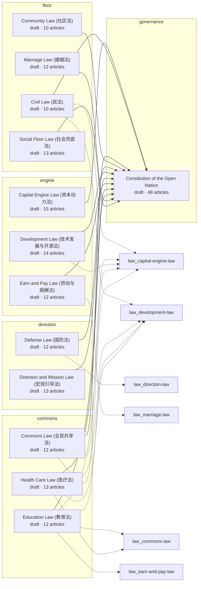

# Law graph

> Generated by `node tools/nation.mjs graph` — do not edit by hand.
> Content stamp: 2026-10-10 (newest law history entry)

Solid edges point to the Constitution articles a law references; dashed edges are cross-references between laws.

